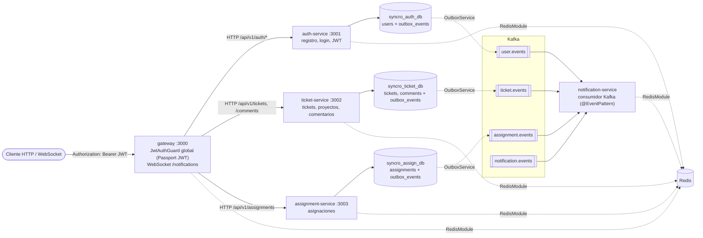
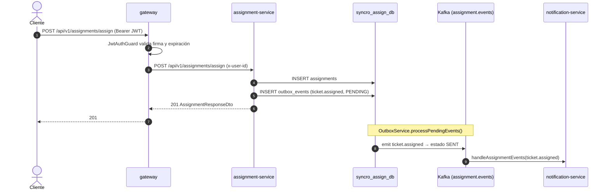

# SyncroBoard Tasks System

[](https://github.com/AZapata27/SyncroBoard-Tasks-System/actions/workflows/ci.yml) [](https://scorecard.dev/viewer/?uri=github.com/AZapata27/SyncroBoard-Tasks-System)

Sistema de gestión de tareas estilo JIRA construido con arquitectura de microservicios, NestJS, Nx Monorepo y comunicación event-driven con Kafka.

## 🏗️ Arquitectura

### Microservicios

- **auth-service** (Port 3001): Autenticación y gestión de usuarios con JWT
- **gateway** (Port 3000): API Gateway que enruta requests a los microservicios
- **ticket-service** (Port 3002): Gestión de tickets, proyectos y comentarios
- **assignment-service** (Port 3003): Asignación de usuarios a tickets
- **notification-service** (Port 3004): Consumidor de eventos Kafka para notificaciones

### Infraestructura

- **PostgreSQL** (3 databases): Base de datos por servicio (Database per Service pattern)
  - syncro_auth_db (Port 5432)
  - syncro_ticket_db (Port 5433)
  - syncro_assign_db (Port 5434)
- **Redis** (Port 6379): Cache y sesiones
- **Kafka + Zookeeper** (Ports 9092, 2181): Message broker para eventos
- **Kafka UI** (Port 8080): Interfaz web para monitoreo de Kafka

### Librerías Compartidas

- **@app/contracts**: Eventos, DTOs y Enums compartidos
- **@app/common**: Módulos reutilizables (Kafka, Redis, Guards, Decorators, Interceptors, Outbox)

## Arquitectura (diagrama)

Vista basada en el código actual: el gateway valida el JWT y hace de proxy HTTP hacia cada servicio; cada servicio
escribe en su propia base PostgreSQL y registra sus eventos de dominio en una tabla `outbox_events` (Transactional
Outbox), desde donde `OutboxService` los publica en Kafka; `notification-service` los consume.



Flujo "asignar ticket → evento → notificación":



Notas sobre el estado actual del código:

- **Tópicos Kafka** (`KAFKA_TOPICS` en `@app/contracts`): `user.events`, `ticket.events`, `assignment.events` y
  `notification.events` (este último sólo tiene consumidor; ningún servicio publica en él todavía).
- **Relay del outbox:** `OutboxService.processPendingEvents()` publica los eventos `PENDING` en Kafka, pero todavía
  no está programado (no hay `@Cron`/`@Interval` que lo invoque), así que hoy los eventos quedan en `outbox_events`.
- **Redis:** `RedisModule` está registrado en todos los servicios (prefijos `gateway:`, `auth:`, `ticket:`,
  `assignment:`, `notification:`), pero por ahora sólo abre la conexión; ningún flujo lee ni escribe en él.
- **Notificaciones:** los handlers de `notification-service` registran el evento recibido; el envío real (email,
  WebSocket del gateway) está pendiente.

## 🚀 Stack Tecnológico

- **Backend**: Node.js 20 LTS, NestJS 10.x, TypeScript 5.x
- **Database**: PostgreSQL 15.x con TypeORM 0.3.x
- **Message Broker**: Apache Kafka 3.x
- **Cache**: Redis 7.x con ioredis
- **Monorepo**: Nx 18.x
- **Authentication**: JWT con Passport
- **Validation**: class-validator, class-transformer
- **Testing**: Jest 29.x
- **Patterns**: Transactional Outbox Pattern, Database per Service, API Gateway

## 📋 Pre-requisitos

- Node.js 20.x o superior
- Docker y Docker Compose
- npm o yarn

## 🛠️ Instalación

### 1. Clonar el repositorio

```bash
git clone <repository-url>
cd SyncroBoard-Tasks-System
```

### 2. Instalar dependencias

```bash
npm install --legacy-peer-deps
```

### 3. Configurar variables de entorno

Copiar los archivos `.env.example` a `.env` en cada servicio:

```bash
# Auth Service
cp apps/auth-service/.env.example apps/auth-service/.env

# Gateway
cp apps/gateway/.env.example apps/gateway/.env

# Ticket Service
cp apps/ticket-service/.env.example apps/ticket-service/.env

# Assignment Service
cp apps/assignment-service/.env.example apps/assignment-service/.env

# Notification Service
cp apps/notification-service/.env.example apps/notification-service/.env
```

### 4. Levantar infraestructura con Docker

```bash
npm run infra:up
```

Esto iniciará:
- PostgreSQL (3 instancias)
- Redis
- Kafka + Zookeeper
- Kafka UI

Verificar que todos los contenedores estén corriendo:

```bash
docker-compose ps
```

Ver logs de infraestructura:

```bash
npm run infra:logs
```

### 5. Ejecutar las migraciones de base de datos

Las bases de datos se crean automáticamente con `synchronize: true` en desarrollo. Para producción, usar migraciones TypeORM.

## 🎯 Ejecución

### Desarrollo - Modo Individual

Ejecutar cada servicio en una terminal separada:

```bash
# Terminal 1 - Auth Service
npm run dev:auth

# Terminal 2 - API Gateway
npm run dev:gateway

# Terminal 3 - Ticket Service
npm run dev:ticket

# Terminal 4 - Assignment Service
npm run dev:assignment

# Terminal 5 - Notification Service
npm run dev:notification
```

### Build de Producción

```bash
# Build todos los servicios
npm run build:all

# Build servicio específico
nx build auth-service
nx build gateway
nx build ticket-service
nx build assignment-service
nx build notification-service
```

## 🧪 Testing

```bash
# Ejecutar todos los tests
npm run test:all

# Test de un servicio específico
nx test auth-service
nx test ticket-service

# Test con coverage
nx test auth-service --coverage
```

## 🔍 Linting

```bash
# Lint todos los proyectos
npm run lint:all

# Lint proyecto específico
nx lint auth-service

# Fix automático
nx lint auth-service --fix
```

## 📚 Documentación de APIs

### Auth Service (Port 3001)

**Base URL**: `http://localhost:3001/api/v1`

#### Endpoints Públicos

```bash
# Registro
POST /auth/register
Content-Type: application/json
{
  "email": "user@example.com",
  "password": "password123",
  "firstName": "John",
  "lastName": "Doe"
}

# Login
POST /auth/login
{
  "email": "user@example.com",
  "password": "password123"
}

# Refresh Token
POST /auth/refresh
{
  "refreshToken": "your-refresh-token"
}
```

#### Endpoints Protegidos (requieren Bearer Token)

```bash
# Obtener perfil
GET /auth/me
Authorization: Bearer <access_token>

# Logout
POST /auth/logout
Authorization: Bearer <access_token>
```

### Gateway (Port 3000)

**Base URL**: `http://localhost:3000/api/v1`

Actúa como proxy para todos los servicios. Usa las mismas rutas que los servicios individuales.

### Ticket Service (Port 3002)

**Base URL**: `http://localhost:3002/api/v1`

```bash
# Crear ticket
POST /tickets
Authorization: Bearer <token>
{
  "projectId": "uuid",
  "title": "Fix login bug",
  "description": "Users cannot login",
  "type": "BUG",
  "priority": "HIGH"
}

# Listar tickets
GET /tickets?projectId=uuid&status=TODO&page=1&limit=20

# Obtener ticket
GET /tickets/:id

# Actualizar ticket
PUT /tickets/:id
{
  "status": "IN_PROGRESS",
  "priority": "HIGHEST"
}

# Eliminar ticket (solo ADMIN o PROJECT_MANAGER)
DELETE /tickets/:id

# Crear comentario
POST /comments
{
  "ticketId": "uuid",
  "content": "Working on this issue"
}

# Obtener comentarios de un ticket
GET /comments/ticket/:ticketId
```

### Assignment Service (Port 3003)

**Base URL**: `http://localhost:3003/api/v1`

```bash
# Asignar usuario a ticket
POST /assignments/assign
Authorization: Bearer <token>
{
  "ticketId": "uuid",
  "userId": "uuid"
}

# Desasignar usuario
POST /assignments/unassign
{
  "ticketId": "uuid",
  "userId": "uuid"
}

# Listar asignaciones
GET /assignments?ticketId=uuid&userId=uuid&page=1&limit=20

# Asignaciones de un ticket
GET /assignments/ticket/:ticketId

# Asignaciones de un usuario
GET /assignments/user/:userId
```

## 🔐 Autenticación

Todos los endpoints protegidos requieren un JWT Bearer token:

```bash
Authorization: Bearer <access_token>
```

### Roles de Usuario

- **ADMIN**: Acceso completo
- **PROJECT_MANAGER**: Puede gestionar proyectos y eliminar tickets
- **DEVELOPER**: Puede crear y actualizar tickets
- **VIEWER**: Solo lectura

## 📊 Monitoreo

### Kafka UI

Acceder a `http://localhost:8080` para monitorear:
- Topics
- Mensajes
- Consumer groups
- Brokers

### Logs de Servicios

```bash
# Ver logs de un servicio específico
docker-compose logs -f kafka
docker-compose logs -f postgres-auth
docker-compose logs -f redis
```

## 🏗️ Estructura del Proyecto

```
syncroboard-monorepo/
├── apps/
│   ├── auth-service/          # Servicio de autenticación
│   ├── gateway/               # API Gateway
│   ├── ticket-service/        # Servicio de tickets
│   ├── assignment-service/    # Servicio de asignaciones
│   └── notification-service/  # Servicio de notificaciones
├── libs/
│   ├── common/                # Módulos compartidos
│   └── contracts/             # Contratos compartidos (DTOs, Events, Enums)
├── infrastructure/
│   ├── docker/                # Dockerfiles
│   ├── terraform/             # IaC para AWS
│   └── scripts/               # Scripts de deployment
├── docs/
│   └── specs/                 # Especificaciones técnicas
├── docker-compose.yml         # Infraestructura local
├── nx.json                    # Configuración Nx
├── tsconfig.base.json         # TypeScript base config
└── package.json               # Dependencies y scripts
```

## 🔄 Patrones Implementados

### Transactional Outbox Pattern

Los eventos se guardan en una tabla `outbox_events` en la misma transacción que los cambios de datos. Un proceso periódico los publica a Kafka, garantizando consistencia eventual.

### Database per Service

Cada microservicio tiene su propia base de datos PostgreSQL:
- Desacoplamiento total
- Escalabilidad independiente
- Aislamiento de datos

### Event-Driven Architecture

Los servicios se comunican mediante eventos de Kafka:
- user.events
- ticket.events
- assignment.events
- notification.events

## 🐛 Troubleshooting

### Los servicios no pueden conectarse a PostgreSQL

Verificar que los contenedores estén running:
```bash
docker-compose ps
```

Reiniciar infraestructura:
```bash
npm run infra:down
npm run infra:up
```

### Error de peer dependencies

Usar flag `--legacy-peer-deps`:
```bash
npm install --legacy-peer-deps
```

### Puerto ya en uso

Cambiar puertos en archivos `.env` de cada servicio.

### Kafka no está disponible

Esperar ~30 segundos después de `docker-compose up` para que Kafka esté completamente iniciado.

## 📝 Próximos Pasos

- [ ] Implementar WebSockets en Gateway para notificaciones real-time
- [ ] Agregar frontend con Next.js 14
- [ ] Implementar circuit breaker pattern
- [ ] Agregar Prometheus + Grafana para observabilidad
- [ ] Implementar autoscaling con K8s
- [ ] Agregar tests E2E con Playwright
- [ ] CI/CD pipeline con GitHub Actions
- [ ] Deploy a AWS ECS con Terraform

## 📄 Licencia

MIT

## 👥 Contribuciones

Las contribuciones son bienvenidas. Por favor:
1. Fork el proyecto
2. Crear feature branch (`git checkout -b feature/AmazingFeature`)
3. Commit cambios (`git commit -m 'Add AmazingFeature'`)
4. Push a branch (`git push origin feature/AmazingFeature`)
5. Abrir Pull Request

## 📞 Soporte

Para issues y preguntas, abrir un issue en GitHub.
